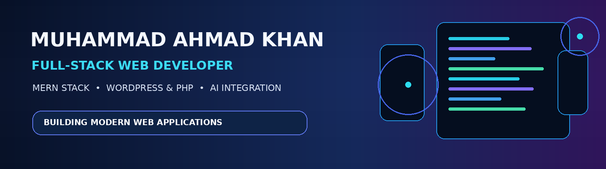
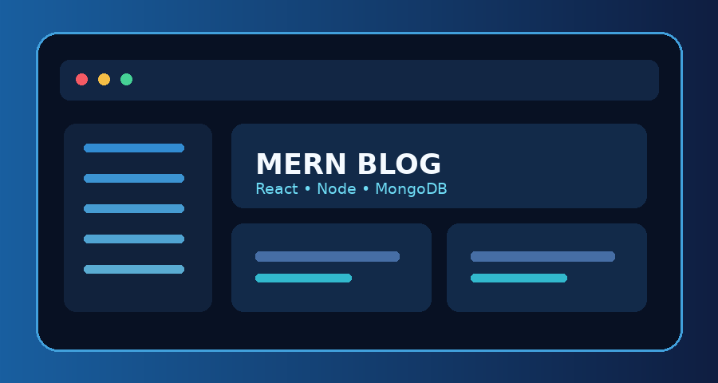
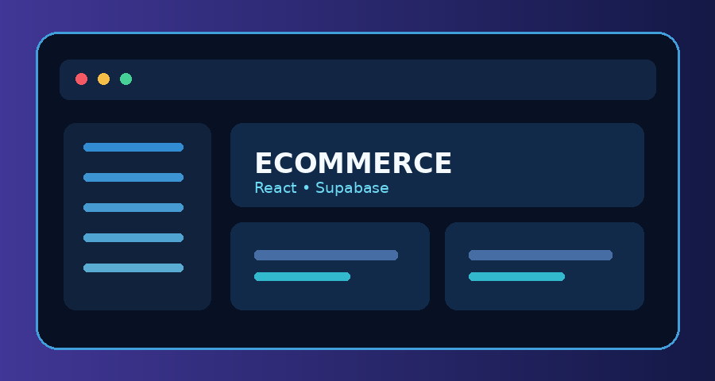
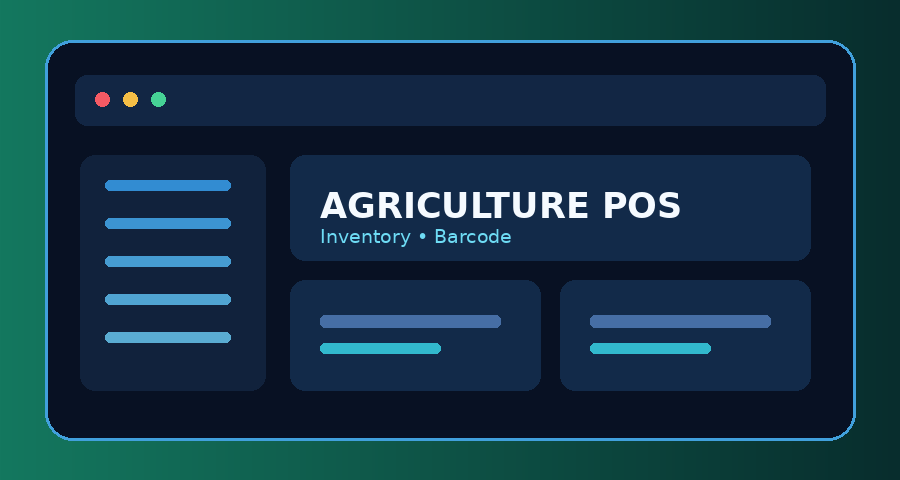
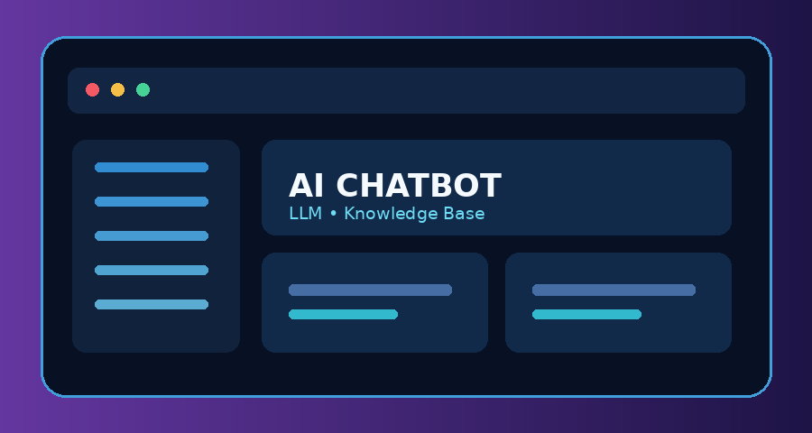
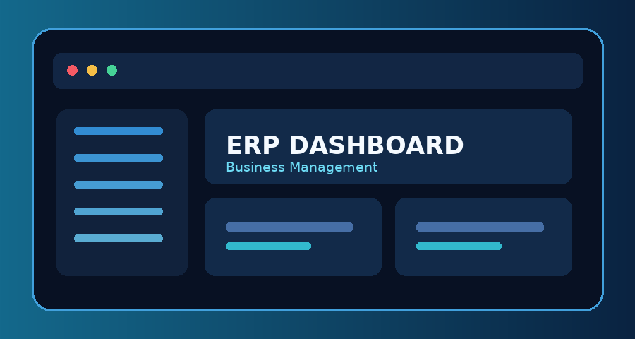

<div align="center">



# 👋 Hi, I'm Muhammad Ahmad Khan

### Full-Stack Web Developer | MERN Stack | WordPress & PHP | AI Integration

[](https://github.com/ahmadkhan32)

</div>

I'm a Full-Stack Web Developer passionate about designing, developing, and deploying modern, responsive, and maintainable web applications. I work across frontend interfaces, backend services, databases, APIs, authentication, and third-party integrations.

---

## 👨‍💻 About Me

- 🔭 **Currently working on:** Full-stack web applications, SaaS platforms, eCommerce systems, ERP solutions, and AI chatbot concepts.
- 👯 **Looking to collaborate on:** MERN Stack, React.js, Node.js, WordPress, PHP, and AI-powered projects.
- 🤝 **Interested in learning more about:** Advanced AI engineering, RAG systems, AI agents, cloud architecture, and DevOps.
- 🌱 **Currently learning:** Generative AI, LLMs, RAG, AI automation, and system design.
- 💬 **Ask me about:** Frontend development, backend development, REST APIs, databases, WordPress, PHP, and MERN Stack.
- ⚡ **Fun fact:** I enjoy turning business requirements into practical software solutions.

## 🎨 Frontend Development

**Technologies**

<p>
  
</p>

**Skills**
- HTML5, semantic markup, accessible forms, and page structure
- CSS3, Flexbox, Grid, responsive design, transitions, and animations
- JavaScript ES6+, DOM, modules, promises, and async/await
- React.js, JSX, functional components, props, state, and hooks
- React Router, Context API, reusable components, and protected routes
- Tailwind CSS, Bootstrap, mobile-first layouts, and UI implementation
- Axios / Fetch API integration, form validation, and dashboard interfaces
- Vite, npm, Chrome DevTools, and React Developer Tools

## ⚙️ Backend Development

**Technologies**

<p>
  
</p>

**Skills**
- Node.js and Express.js application development
- RESTful API design and implementation
- MVC-style separation of routes, controllers, services, and models
- CRUD operations, middleware, request validation, and error handling
- Authentication, authorization, JWT, and role-based access control
- File upload handling, pagination, filtering, and search
- Third-party API integrations, webhooks, and business logic
- PHP server-side development and WordPress custom functionality

## 🗄️ Database Development

<p>
  
</p>

- **MongoDB:** collections, documents, schema design, Mongoose, indexes, and aggregation
- **PostgreSQL / Supabase:** relational schema, SQL, joins, relationships, RLS, Auth, and Storage
- **MySQL:** relational database design, CRUD, joins, keys, and query optimization
- Data modeling, validation, indexing, normalization, and multi-tenant design concepts

## 🔐 Authentication & Security

- Registration and login workflows
- JWT authentication and protected routes
- Password hashing and secure credential handling
- Role-Based Access Control (RBAC)
- Supabase Auth and Row Level Security (RLS)
- API authorization, input validation, and CORS configuration
- Environment variables and secure configuration practices

## 🌐 WordPress & PHP Development

<p>
  
</p>

- WordPress CMS setup and customization
- Custom themes, plugins, and PHP functionality
- WordPress hooks, filters, and REST API
- WooCommerce product, cart, checkout, and order customization
- Custom product pages, AJAX cart interactions, and payment/shipping integrations
- Elementor, Astra, custom fields, and WPCode

## 🤖 AI & Automation

- OpenAI API integration and LLM application concepts
- AI chatbot development and conversation workflows
- Retrieval-Augmented Generation (RAG) and knowledge-base concepts
- AI agents, prompt engineering, and vector-search concepts
- Make.com, webhooks, API automation, and business workflows

## 🔗 API Development & Integration

- REST API development and consumption
- HTTP methods: GET, POST, PUT, PATCH, and DELETE
- Axios, Fetch, JSON, and Express Router
- Webhooks and third-party API integrations
- Authentication, payment, eCommerce, WordPress, and Supabase APIs
- API testing with Postman and structured error responses

## ☁️ Hosting, Deployment & DevOps

<p>
  
</p>

- Hostinger, Vercel, cPanel, and GitHub-based workflows
- Domain and DNS configuration, SSL / HTTPS, and environment setup
- Git, GitHub, branching, commits, and pull requests
- Production builds, deployment troubleshooting, and CI/CD concepts
- GitHub Actions and containerization concepts

---

## 💻 Technology Stack at a Glance

| Area | Technologies |
|---|---|
| Frontend | HTML5, CSS3, JavaScript, React.js, Tailwind CSS, Bootstrap |
| Backend | Node.js, Express.js, PHP |
| Databases | MongoDB, PostgreSQL, Supabase, MySQL |
| CMS & eCommerce | WordPress, WooCommerce, Elementor |
| APIs | REST APIs, Axios, Fetch, Webhooks |
| Authentication | JWT, Supabase Auth, RBAC, RLS |
| AI & Automation | OpenAI API, LLMs, RAG concepts, AI Agents, Make.com |
| Tools | Git, GitHub, VS Code, Postman, Figma, Vite |
| Deployment | Hostinger, Vercel, cPanel, GitHub Actions |

## 🏗️ Full-Stack Application Architecture

```text
             USER / BROWSER
                    |
                    v
          FRONTEND - React.js
          Components / Pages / UI
                    |
                    v
             API - HTTP / JSON
             Axios / Fetch
                    |
                    v
        BACKEND - Node.js / Express
        Routes / Controllers / Services
                    |
          +---------+----------+
          |                    |
          v                    v
    AUTH & SECURITY       BUSINESS LOGIC
    JWT / Supabase        Validation / RBAC
          |                    |
          +---------+----------+
                    |
                    v
             DATABASE
       MongoDB / PostgreSQL / MySQL
                    |
                    v
       EXTERNAL APIs / WEBHOOKS / AI
                    |
                    v
          DEPLOYMENT & HOSTING
            Hostinger / Vercel
```

## 🚀 Selected Projects & Development Areas

> Add links to the actual repositories when you publish or share them. The preview images below are illustrative project thumbnails, not screenshots of deployed products.

### 1. MERN Stack Blog Application



**Stack:** React.js, Node.js, Express.js, MongoDB

- User registration and login
- JWT authentication and protected routes
- User dashboard and blog management
- CRUD operations and responsive interface

### 2. eCommerce Product Research System



**Stack:** React.js, Node.js, Express.js, Supabase

- Product research and management
- SEO and keyword organization
- Product listing workflows
- Admin dashboard and database integration

### 3. Agriculture POS & Inventory Management



**Stack:** React.js / Next.js, Supabase, SQL

- Product and inventory management
- Barcode scanner integration
- Sales and purchase workflows
- Customer, supplier, and reporting modules

### 4. Advanced AI Chatbot System



**Stack:** MERN Stack, Supabase, OpenAI API

- AI-powered customer support
- Knowledge-base and RAG concepts
- Conversation management
- AI agents and workflow automation

### 5. Business Management / ERP System



**Stack:** React.js, Node.js, Express.js, Supabase

- Sales and purchase management
- Inventory and customer management
- Role-based access
- Business reports and dashboard analytics

---

## 📊 GitHub Statistics

<div align="center">


</div>

## 📈 Contribution Activity

<div align="center">


</div>

---

## 🤝 Connect With Me

<div align="center">

[](https://github.com/ahmadkhan32)

</div>

## 🎯 My Professional Goal

To build innovative software solutions, develop scalable business applications, explore Artificial Intelligence, and collaborate with developers worldwide.

**Thanks for visiting my GitHub profile! Let's build, innovate, and grow together. 🚀**
# ahmadkhan32

# ahmadkhan32

